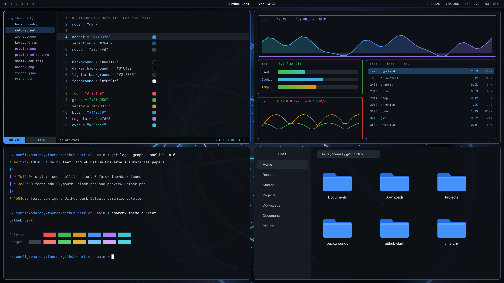
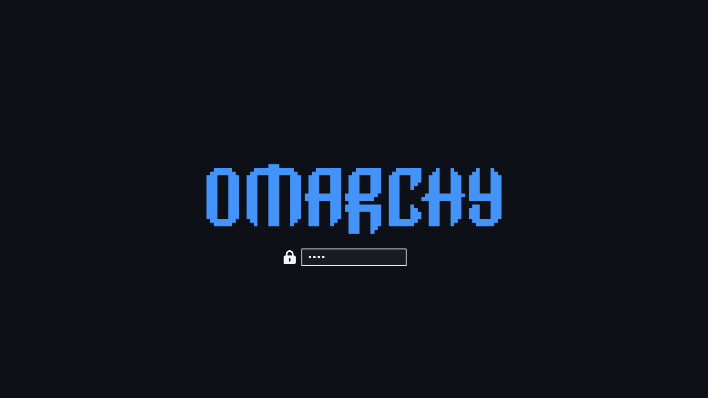

# GitHub Dark for Omarchy



A complete dark [Omarchy](https://omarchy.org/) theme built around the official **GitHub Dark Default** palette, following the [Omarchy theme manual](https://omarchy.org/manual/making-your-own-theme/).

## Install

Install directly with the Omarchy CLI (or via **Install → Style → Theme** in the Omarchy menu):

```bash
omarchy theme install https://github.com/szaidi-code/omarchy-github-dark-theme.git
```

Omarchy derives the theme name `github-dark` (**Github Dark**) from the repository name and applies it automatically.

Update later with:

```bash
omarchy theme update
```

## Wallpapers

Four 4K (`3840×2160`) GitHub Dark wallpapers are included in `backgrounds/`:

- `1-github-universe.webp` — 3D geodesic GitHub globe with orbital PR traffic arcs *(default)*
- `2-contribution-graph.webp` — 53×7 GitHub contribution graph with glowing commit DAG
- `3-github-aurora.webp` — Minimalist GitHub Dark parametric aurora ribbons
- `omarchy.webp` — Minimalist Omarchy pixel wordmark in GitHub Blue (`#4493f8`) on `#0d1117`

Cycle wallpapers anytime with:

```bash
omarchy theme bg next
```

## Unlock Screen



Includes transparent `unlock.png` and `preview-unlock.png` assets so `github-dark` appears under **Appearance → Unlock**, or apply directly with:

```bash
omarchy plymouth set-by-theme github-dark
```

## Palette

| Role | Hex |
| --- | --- |
| Canvas (`background`) | `#0d1117` |
| Deep surface (`dark_background`) | `#080b10` |
| Inset / deepest (`darker_background`) | `#010409` |
| Raised surface (`lighter_background`) | `#212830` |
| Primary text (`foreground`) | `#f0f6fc` |
| Secondary text (`light_foreground`) | `#b1bac4` |
| Muted text (`dark_foreground`) | `#6e7681` |
| Border / muted (`muted`) | `#3d444d` |
| Accent / link (`accent`, `blue`) | `#4493f8` |
| Active border (`hyprland_active_border`) | `rgba(4493f8ee) rgba(1f6febee) 45deg` |
| Inactive border (`hyprland_inactive_border`) | `rgba(3d444daa)` |
| Success (`green`) | `#3fb950` |
| Warning (`yellow`) | `#d29922` |
| Danger (`red`) | `#f85149` |
| Purple (`magenta`) | `#ab7df8` |

## What's Included

- **`colors.toml`** — Canonical Omarchy semantic palette (`mode = "dark"`, Hyprland borders, full ANSI + bright colors) used by Omarchy templates to theme terminals (Ghostty, Foot, Alacritty, Kitty), Hyprland, Omarchy shell, btop, Chromium, Helix, Neovim, VS Code, Obsidian, and agents.
- **`backgrounds/`** — Four 4K WebP wallpapers.
- **`preview.png`** — `2560×1440` desktop preview for `omarchy theme switcher`.
- **`unlock.png` & `preview-unlock.png`** — Plymouth boot/unlock assets.
- **`icons.theme`** — `Yaru-blue-dark` icon theme matching `#4493f8`.
- **`keyboard.rgb`** — `4493f8` RGB keyboard backlight color.
- **`shell.lock.toml`** — Full `[lock]` screen section override for GitHub Dark idle/focus/error states.
- **Zero restricted files** — No `.lua`, terminal launch configs, or `vscode.json` are shipped, so `omarchy theme install` installs cleanly without warnings.

## License

[MIT](LICENSE), copyright 2026 szaidi-code.
